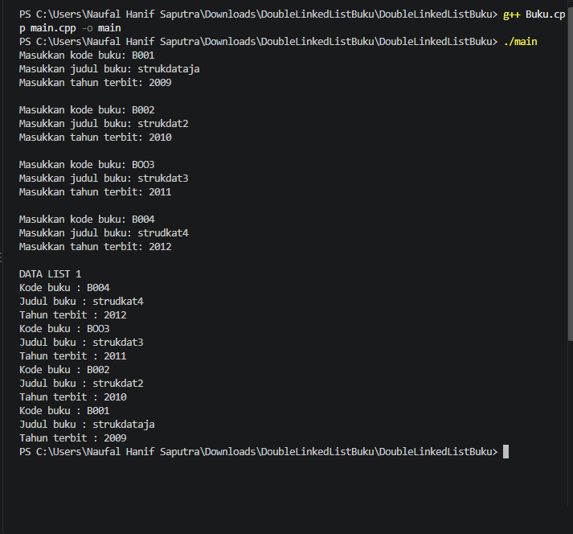
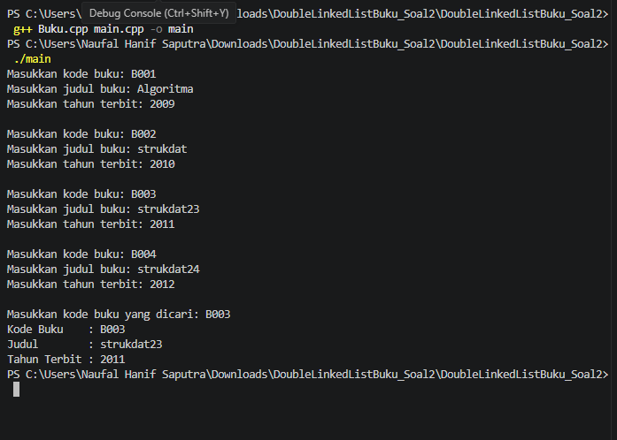
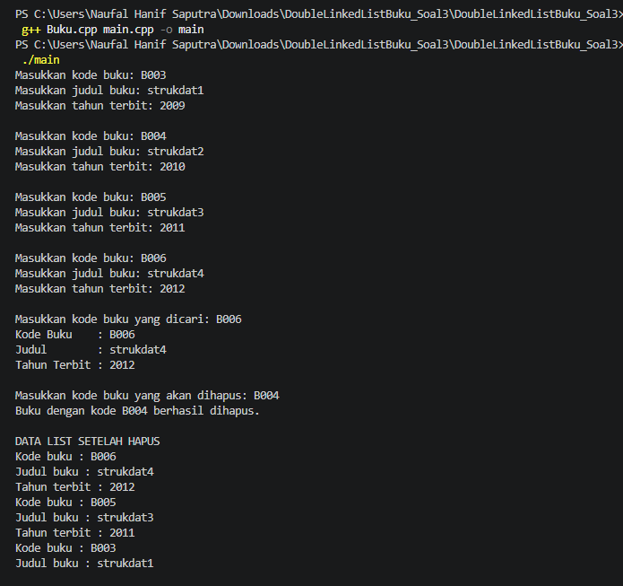

<h1 align="center">Laporan Praktikum Modul 6 DOUBLY LINKED LIST (BAGIAN PERTAMA)</h1>

Naufal Hanif Saputra - 109082500209

Dasar Teori

Doubly Linked List adalah struktur data berantai yang setiap node-nya memiliki dua penunjuk, yaitu next untuk menuju node sesudahnya dan prev untuk kembali ke node sebelumnya. Selain menyimpan data (info), tiap node juga menyimpan alamat tetangganya, sehingga list dapat ditelusuri maju maupun mundur dan operasi seperti penyisipan, pencarian, dan penghapusan bisa dilakukan dari kedua sisi. Pada praktikum ini, struktur tersebut dipakai untuk mengelola data buku yang berisi kode buku, judul, dan tahun terbit, dengan operasi menambah data, mencari data berdasarkan kode, serta menghapus node dari list.

Guided
1. Doublylist..h
C
#ifndef DOUBLYLIST_H
#define DOUBLYLIST_H

#include <iostream>
#include <string>

#define Nil NULL

// Latihan 1
struct infotype {
    std::string nopol; 
    std::string warna; 
    int thnBuat;      
};
typedef struct elmlist *address;
struct elmlist {
    infotype info;  
    address next;   
    address prev;   
};
struct List {
    address First; 
    address Last;  
};

// Latihan 1
void CreateList(List &L);
address alokasi(infotype x);
void dealokasi(address &P);
void printInfo(List L);
void insertLast(List &L, address P);

// Latihan 2

address findElm(List L, std::string nopol);

// Latihan 3
void deleteFirst(List &L, address &P);
void deleteLast(List &L, address &P);
void deleteAfter(List &L, address Prec, address &P);
void deleteElm(List &L, std::string nopol, bool &status);

#endif
2. Doublylist.cpp
C
#include "Doublylist.h"

// Latihan 1
void CreateList(List &L) {
    L.First = Nil;
    L.Last = Nil;
}

address alokasi(infotype x) {
    address P = new elmlist;
    P->info = x;
    P->next = Nil;
    P->prev = Nil; 
    return P;
}

void dealokasi(address &P) {
    delete P;
}

void printInfo(List L) {
    address P = L.Last;
    if (P == Nil) {
        std::cout << "List kosong." << std::endl;
        return;
    }
    while (P != Nil) {
        std::cout << "no polisi : " << P->info.nopol << std::endl;   
        std::cout << "warna     : " << P->info.warna << std::endl;   
        std::cout << "tahun     : " << P->info.thnBuat << std::endl; 
        P = P->prev;
    }
}

void insertLast(List &L, address P) {
    if (L.First == Nil) { 
        L.First = P;
        L.Last = P;
    } else {
        P->prev = L.Last;         
        (L.Last)->next = P;     
        L.Last = P;               
    }
}

// Latihan 2
address findElm(List L, std::string nopol) {
    address P = L.First;
    while (P != Nil) {
        if (P->info.nopol == nopol) {
            return P;
        }
        P = P->next;
    }
    return Nil;
}

// Latihan 3
void deleteFirst(List &L, address &P) {
    if (L.First == Nil) return;

    P = L.First; 
    if (L.First == L.Last) { 
        L.First = Nil;
        L.Last = Nil;
    } else {
        L.First = P->next;     
        (L.First)->prev = Nil; 
        P->next = Nil;         
    }
}

void deleteLast(List &L, address &P) {
    if (L.First == Nil) return;

    P = L.Last; 
    if (L.First == L.Last) { 
        L.First = Nil;
        L.Last = Nil;
    } else {
        L.Last = P->prev;      
        (L.Last)->next = Nil; 
        P->prev = Nil;         
    }
}

void deleteAfter(List &L, address Prec, address &P) {
    if (Prec == Nil || Prec->next == Nil) return;

    P = Prec->next;
    if (P == L.Last) {
        deleteLast(L, P);
    } else {
        Prec->next = P->next;     
        (P->next)->prev = Prec; 
        P->next = Nil;            
        P->prev = Nil;           
    }
}

void deleteElm(List &L, std::string nopol, bool &status) {
    address P = findElm(L, nopol);
    status = false;

    if (P != Nil) {
        if (P == L.First) {
            deleteFirst(L, P);
        } else if (P == L.Last) {
            deleteLast(L, P);
        } else {
            address Prec = P->prev;
            deleteAfter(L, Prec, P);
        }
        dealokasi(P); 
        status = true;
    }
}
3. main.cpp
C
#include <iostream>
#include "Doublylist.h"
using namespace std;

void inputData(List &L) {
    infotype data;
    address P;

    cout << "masukkan nomor polisi: "; cin >> data.nopol;
    cout << "masukkan warna kendaraan: "; cin >> data.warna;
    cout << "masukkan tahun kendaraan: "; cin >> data.thnBuat;
    if (findElm(L, data.nopol) == Nil) {
        P = alokasi(data); 
        insertLast(L, P);  
    } else {
        cout << "nomor polisi sudah terdaftar" << endl; 
    }
}

int main() {
    List L;
    CreateList(L); 
    address P;

    // Latihan 1
    inputData(L); 
    inputData(L); 
    inputData(L); 
    inputData(L); 

    cout << "\nDATA LIST 1" << endl; 
    printInfo(L); 

    // Latihan 2
    string nopolCari;
    cout << "\nMasukkan Nomor Polisi yang dicari : "; 
    cin >> nopolCari; 
    
    P = findElm(L, nopolCari); 
    if (P != Nil) {
        cout << "Nomor Polisi : " << P->info.nopol << endl; 
        cout << "Warna        : " << P->info.warna << endl; 
        cout << "Tahun        : " << P->info.thnBuat << endl; 
    } else {
        cout << "Data dengan nomor polisi " << nopolCari << " tidak ditemukan." << endl;
    }

    // Latihan 3
    string nopolHapus;
    bool hapusBerhasil;
    cout << "\nMasukkan Nomor Polisi yang akan dihapus : ";
    cin >> nopolHapus;

    deleteElm(L, nopolHapus, hapusBerhasil); 

    if (hapusBerhasil) {
        cout << "Data dengan nomor polisi " << nopolHapus << " berhasil dihapus." << endl; 
    } else {
        cout << "Data dengan nomor polisi " << nopolHapus << " tidak ditemukan." << endl;
    }
    cout << "\nDATA LIST 1" << endl; 
    printInfo(L); 

    return 0;
}
Unguided
1.
Buku.h
C
#ifndef BUKU_H
#define BUKU_H

#include <iostream>
#include <string>
using namespace std;

struct buku {
    string kodeBuku;
    string judul;
    int thnTerbit;
};

typedef buku infotype;

struct ElmList;
typedef ElmList* address;

struct ElmList {
    infotype info;
    address next;
    address prev;
};

struct List {
    address First;
    address Last;
};

void CreateList(List &L);
address alokasi(infotype x);
void dealokasi(address &P);
void printInfo(List L);
void insertLast(List &L, address P);

#endif
Buku.cpp
#include "Buku.h"

void CreateList(List &L) {
    L.First = NULL;
    L.Last = NULL;
}

address alokasi(infotype x) {
    address P = new ElmList;
    P->info = x;
    P->next = NULL;
    P->prev = NULL;
    return P;
}

void dealokasi(address &P) {
    delete P;
    P = NULL;
}

void insertLast(List &L, address P) {
    if (L.First == NULL) {
        L.First = P;
        L.Last = P;
    }else {
        P->prev = L.Last;
        L.Last->next = P;
        L.Last = P;
    }
}

void printInfo(List L) {
    address P = L.Last;

    while(P != NULL) {
        cout << "Kode buku : " << P->info.kodeBuku << endl;
        cout << "Judul buku : " << P->info.judul << endl;
        cout << "Tahun terbit : " << P->info.thnTerbit << endl;
        P = P->prev;
    }
}
main.cpp

#include "Buku.h"

int main() {
    List L;
    infotype x;
    address P;

    CreateList(L);

    for (int i = 0; i < 4; i++) {
        cout << "Masukkan kode buku: ";
        cin >> x.kodeBuku;

        cout << "Masukkan judul buku: ";
        cin >> x.judul;

        cout << "Masukkan tahun terbit: ";
        cin >> x.thnTerbit;

        P = L.First;
        bool ada = false;

        while (P != NULL) {
            if (P->info.kodeBuku == x.kodeBuku) {
                ada = true;
                break;
            }
            P = P->next;
        }

        if (ada) {
            cout << "Kode buku sudah terdaftar!" << endl;
        } else {
            insertLast(L, alokasi(x));
        }

        cout << endl;
    }

    cout << "DATA LIST 1" << endl;
    printInfo(L);

    return 0;
}
Output Unguided 1 :
Output 1

g
Tampilkan Gambar

Pada unguided 1, saya membuat ADT Doubly Linked List dalam C++ untuk menyimpan data buku. Program membaca empat data buku, lalu sebelum menambahkan memeriksa apakah kode buku sudah ada di list; jika sudah, data tidak ditambahkan dan muncul pesan bahwa kode sudah terdaftar. Data yang lolos pemeriksaan dimasukkan lewat insertLast, kemudian seluruh isi list ditampilkan dengan printInfo yang menelusuri dari node terakhir ke node pertama menggunakan pointer prev. Dari soal ini saya memahami bagaimana node saling terhubung lewat next dan prev.

2.
Buku.h
C
#ifndef BUKU_H
#define BUKU_H

#include <iostream>
#include <string>
using namespace std;

struct buku {
    string kodeBuku;
    string judul;
    int thnTerbit;
};

typedef buku infotype;

struct ElmList;
typedef ElmList* address;

struct ElmList {
    infotype info;
    address next;
    address prev;
};

struct List {
    address First;
    address Last;
};

void CreateList(List &L);
address alokasi(infotype x);
void dealokasi(address &P);
void printInfo(List L);
void insertLast(List &L, address P);
address findElm(List L, infotype x);

#endif
Buku.cpp
C
#include "Buku.h"

void CreateList(List &L) {
    L.First = NULL;
    L.Last = NULL;
}

address alokasi(infotype x) {
    address P = new ElmList;
    P->info = x;
    P->next = NULL;
    P->prev = NULL;
    return P;
}

void dealokasi(address &P) {
    delete P;
    P = NULL;
}

void insertLast(List &L, address P) {
    if (L.First == NULL) {
        L.First = P;
        L.Last = P;
    }else {
        P->prev = L.Last;
        L.Last->next = P;
        L.Last = P;
    }
}

void printInfo(List L) {
    address P = L.Last;

    while(P != NULL) {
        cout << "Kode buku : " << P->info.kodeBuku << endl;
        cout << "Judul buku : " << P->info.judul << endl;
        cout << "Tahun terbit : " << P->info.thnTerbit << endl;
        P = P->prev;
    }
}

address findElm(List L, infotype x) {
    address P = L.First;

    while (P != NULL) {
        if (P->info.kodeBuku == x.kodeBuku) {
            return P;
        }
        P = P->next;
    }

    return NULL;
}
main.cpp
C

#include "Buku.h"

int main() {
    List L;
    infotype x, cari;
    address P;
    bool ada;

    CreateList(L);

    for (int i = 0; i < 4; i++) {
        cout << "Masukkan kode buku: ";
        cin >> x.kodeBuku;

        cout << "Masukkan judul buku: ";
        cin >> x.judul;

        cout << "Masukkan tahun terbit: ";
        cin >> x.thnTerbit;

        P = L.First;
        ada = false;

        while (P != NULL) {
            if (P->info.kodeBuku == x.kodeBuku) {
                ada = true;
                break;
            }
            P = P->next;
        }

        if (ada) {
            cout << "Kode buku sudah terdaftar!" << endl;
        } else {
            insertLast(L, alokasi(x));
        }

        cout << endl;
    }

    cout << "Masukkan kode buku yang dicari: ";
    cin >> cari.kodeBuku;

    P = findElm(L, cari);

    if (P != NULL) {
        cout << "Kode Buku    : " << P->info.kodeBuku << endl;
        cout << "Judul        : " << P->info.judul << endl;
        cout << "Tahun Terbit : " << P->info.thnTerbit << endl;
    } else {
        cout << "Buku tidak ditemukan!" << endl;
    }

    return 0;
}
Output Unguided 2 :
Output 1

Tampilkan Gambar

Pada unguided 2, saya menambahkan fungsi findElm() untuk mencari buku berdasarkan kode buku. Fungsi ini menelusuri list dari node pertama dengan pointer next dan membandingkan kode setiap node dengan kode yang dicari. Jika cocok, alamat node dikembalikan sehingga kode, judul, dan tahun terbit buku bisa ditampilkan; jika sampai akhir list tidak ada yang cocok, fungsi mengembalikan NULL dan program menampilkan pesan bahwa buku tidak ditemukan. Dari soal ini saya memahami proses pencarian data pada Doubly Linked List.

3.
Buku.h
C
#ifndef BUKU_H
#define BUKU_H

#include <iostream>
#include <string>
using namespace std;

struct buku {
    string kodeBuku;
    string judul;
    int thnTerbit;
};

typedef buku infotype;

struct ElmList;
typedef ElmList* address;

struct ElmList {
    infotype info;
    address next;
    address prev;
};

struct List {
    address First;
    address Last;
};

void CreateList(List &L);
address alokasi(infotype x);
void dealokasi(address &P);
void printInfo(List L);
void insertLast(List &L, address P);
address findElm(List L, infotype x);

void deleteFirst(List &L, address &P);
void deleteLast(List &L, address &P);
void deleteAfter(address Prec, address &P);

#endif
Buku.cpp
C
#include "Buku.h"

void CreateList(List &L) {
    L.First = NULL;
    L.Last = NULL;
}

address alokasi(infotype x) {
    address P = new ElmList;
    P->info = x;
    P->next = NULL;
    P->prev = NULL;
    return P;
}

void dealokasi(address &P) {
    delete P;
    P = NULL;
}

void insertLast(List &L, address P) {
    if (L.First == NULL) {
        L.First = P;
        L.Last = P;
    }else {
        P->prev = L.Last;
        L.Last->next = P;
        L.Last = P;
    }
}

void printInfo(List L) {
    address P = L.Last;

    while(P != NULL) {
        cout << "Kode buku : " << P->info.kodeBuku << endl;
        cout << "Judul buku : " << P->info.judul << endl;
        cout << "Tahun terbit : " << P->info.thnTerbit << endl;
        P = P->prev;
    }
}

address findElm(List L, infotype x) {
    address P = L.First;

    while (P != NULL) {
        if (P->info.kodeBuku == x.kodeBuku) {
            return P;
        }
        P = P->next;
    }

    return NULL;
}

void deleteFirst(List &L, address &P) {
    P = L.First;
    L.First = P->next;

    if (L.First == NULL) {
        L.Last = NULL;
    } else {
        L.First->prev = NULL;
    }

    P->next = NULL;
}

void deleteLast(List &L, address &P) {
    P = L.Last;
    L.Last = P->prev;

    if (L.Last == NULL) {
        L.First = NULL;
    } else {
        L.Last->next = NULL;
    }

    P->prev = NULL;
}

void deleteAfter(address Prec, address &P) {
    P = Prec->next;
    Prec->next = P->next;

    if (P->next != NULL) {
        P->next->prev = Prec;
    }

    P->next = NULL;
    P->prev = NULL;
}
main.cpp
C

#include "Buku.h"

int main() {
    List L;
    infotype x, cari;
    address P, Prec;
    bool ada;

    CreateList(L);

    for (int i = 0; i < 4; i++) {
        cout << "Masukkan kode buku: ";
        cin >> x.kodeBuku;

        cout << "Masukkan judul buku: ";
        cin >> x.judul;

        cout << "Masukkan tahun terbit: ";
        cin >> x.thnTerbit;

        P = L.First;
        ada = false;

        while (P != NULL) {
            if (P->info.kodeBuku == x.kodeBuku) {
                ada = true;
                break;
            }
            P = P->next;
        }

        if (ada) {
            cout << "Kode buku sudah terdaftar!" << endl;
        } else {
            insertLast(L, alokasi(x));
        }

        cout << endl;
    }

    cout << "Masukkan kode buku yang akan dihapus: ";
    cin >> cari.kodeBuku;

    P = findElm(L, cari);

    if (P != NULL) {
        if (P == L.First) {
            deleteFirst(L, P);
        } else if (P == L.Last) {
            deleteLast(L, P);
        } else {
            Prec = L.First;

            while (Prec->next != P) {
                Prec = Prec->next;
            }

            deleteAfter(Prec, P);
        }

        dealokasi(P);
        cout << "Data dengan kode buku " << cari.kodeBuku
             << " berhasil dihapus." << endl;
    } else {
        cout << "Kode buku tidak ditemukan!" << endl;
    }

    cout << "\nDATA LIST 1\n";
    printInfo(L);

    return 0;
}
Output Unguided 3 :
Output 1

Tampilkan Gambar

Pada unguided 3, saya mengimplementasikan penghapusan data buku berdasarkan kode yang dimasukkan pengguna. Program lebih dulu mencari node dengan findElm(), lalu memilih fungsi hapus sesuai posisinya: deleteFirst() bila node berada di awal, deleteLast() bila di akhir, dan deleteAfter() bila di tengah, dengan node sebelumnya dicari terlebih dahulu dari awal list. Setelah node dilepas dari list, memorinya dibebaskan dengan dealokasi(), lalu isi list yang tersisa ditampilkan kembali. Dari soal ini saya memahami cara memutus dan menyambung ulang pointer next dan prev saat menghapus elemen.

Kesimpulan

Melalui praktikum ini saya belajar membuat dan mengelola ADT Doubly Linked List dalam C++, mulai dari menambah data buku, mencegah kode buku ganda, mencari data berdasarkan kode, sampai menghapus data di awal, tengah, atau akhir list. Saya juga jadi paham bahwa pointer next dan prev membuat setiap elemen terhubung dua arah, sehingga list dapat ditelusuri maju maupun mundur. Dari ketiga soal, saya melihat bahwa pengelolaan data dengan Doubly Linked List menuntut ketelitian dalam mengatur pointer agar list tetap terhubung dengan benar.

Referensi

[1] 1. Modul Praktikum Struktur Data. Modul 6: Doubly Linked List. Materi pembuatan ADT, penambahan data (insert), pencarian data (searching), dan penghapusan data (delete). [2] cppreference. std::list – C++ Reference. Membahas konsep list, penambahan, penghapusan, dan pengelolaan elemen. https://en.cppreference.com/w/cpp/container/list  [3] Stanford University. Pointers and Linked Nodes. Materi mengenai pointer, node, dan konsep linked list dalam C++.  [4] cplusplus.com. The C++ Language Tutorial. Materi dasar bahasa C++, termasuk pointer dan pengelolaan alamat memori.  
